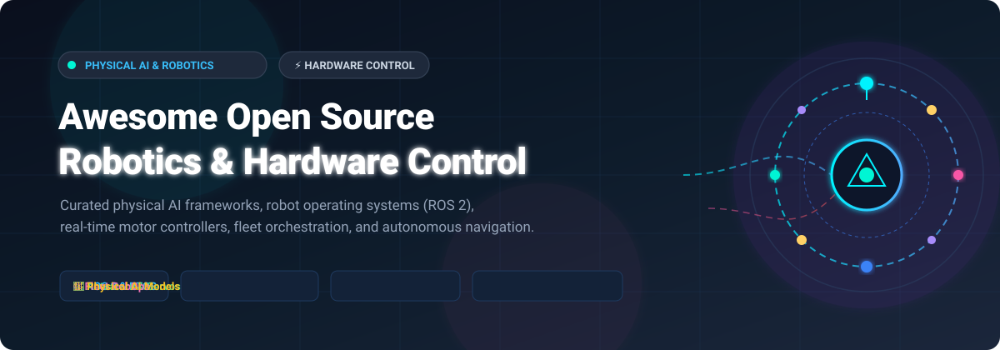

# Awesome Open Source Robotics & Hardware Control

<p align="center">
  
</p>

<p align="center">
  <a href="https://github.com/ishandutta2007/Awesome-Awesome-Awesome"></a>
  <a href="https://discord.gg/jc4xtF58Ve"></a>
  <a href="https://github.com/ishandutta2007/Awesome-Awesome-Awesome"></a>
  <a href="http://creativecommons.org/publicdomain/zero/1.0/"></a>
  <a href="https://github.com/ishandutta2007"></a>
</p>

> 🤖 **A curated directory of premier Open Source Robotics & Hardware Control systems**, physical AI models, real-time motor controllers, robot operating systems (ROS 2), fleet orchestration engines, and simulation tools — paired with an enterprise SaaS platform comparison matrix.
>
> 🌟 **Star this repository if you find it helpful!** 🌟

---

## 📋 Table of Contents

- [🌐 Sector Overview & Market Dynamics](#-sector-overview--market-dynamics)
- [🏢 Commercial & Hosted SaaS Robotics Platforms](#-commercial--hosted-saas-robotics-platforms)
- [🛠️ Open-Source Robotics & Hardware Control Frameworks](#️-open-source-robotics--hardware-control-frameworks)
  - [🤗 LeRobot (Hugging Face)](#-lerobot-hugging-face)
  - [🛩️ ArduPilot](#️-ardupilot)
  - [🦆 Microduck](#-microduck)
  - [🚁 PX4 Autopilot](#-px4-autopilot)
  - [⚙️ ROS 2 (Robot Operating System)](#️-ros-2-robot-operating-system)
  - [🐱 Petoi OpenCat](#-petoi-opencat)
  - [🧭 ROS 2 Navigation (Nav2)](#-ros-2-navigation-nav2)
  - [🌐 Webots](#-webots)
  - [📐 Drake](#-drake)
  - [🦾 MoveIt 2](#-moveit-2)
  - [🎮 Gazebo Sim](#-gazebo-sim)
  - [⚡ Open Dynamic Robot Initiative](#-open-dynamic-robot-initiative)
  - [🎛️ ros2_control](#️-ros2_control)
  - [🔌 micro-ROS](#-micro-ros)
  - [🚦 Open-RMF](#-open-rmf)
  - [🐕 TNY-360](#-tny-360)
  - [☁️ Google Cloud Robotics Core](#️-google-cloud-robotics-core)
  - [📦 Viam RDK](#-viam-rdk)
  - [📊 Foxglove Studio](#-foxglove-studio)
- [📊 Comparison Matrix at a Glance](#-comparison-matrix-at-a-glance)
- [🤝 Contributing](#-contributing)
- [💖 Support & Sponsorship](#-support--sponsorship)
- [📈 Star History](#-star-history)
- [📄 License](#-license)

---

## 🌐 Sector Overview & Market Dynamics

The global cloud robotics and robot operations (RobOps) market is estimated at **$12.05B – $14.2B in 2026** (scaling from ~$7.8B in 2024 at a compound annual growth rate of ~24–28%). 📈

The sector exhibits **moderate fragmentation with multi-tiered concentration**: while hyper-scale cloud simulation and AI acceleration are concentrated among mega-cap providers (NVIDIA, Amazon AWS, Microsoft Azure), the hardware fleet orchestration, teleoperation, and edge hardware abstraction layers remain highly fragmented across specialized RobOps vendors and open-source middleware solving the heterogeneous multi-vendor robot interoperability challenge. 🧩

---

## 🏢 Commercial & Hosted SaaS Robotics Platforms

Commercial, cloud-hosted robotics platforms, RobOps suites, and managed simulation systems. Sorted in descending order by estimated company scale (valuation / market capitalization / funding). 🚀

| 🏢 Platform | 💰 Company Scale (Valuation / Funding / Revenue) | 🏷️ Starting Tier Pricing | 🎁 Free Tier / Trial Limits | 🎯 Core Focus & Deployment Model |
| :--- | :--- | :--- | :--- | :--- |
| **[NVIDIA Isaac Sim](https://developer.nvidia.com/isaac/sim)** | **$3.5T+ Market Cap** (NVIDIA Corporation, public: NVDA) | Free for internal R&D; Enterprise licensing starts at **$4,500 / GPU / year** (via NVIDIA AI Enterprise) | **Free forever** for individual & internal corporate R&D / simulation generation; **90-day free trial** for full NVIDIA AI Enterprise suite | High-fidelity photorealistic physics simulation, synthetic data generation, and Omniverse digital twins. 🌐 |
| **[AWS RoboMaker](https://aws.amazon.com/robomaker/)** | **$2.2T+ Market Cap** (Amazon.com Inc, public: AMZN) | Pay-as-you-go historically at **$0.40 per Simulation Unit (SU)-hour** (1 vCPU, 2 GB RAM) *(Service retired Sept 2025; workload patterns moved to EC2/Batch)* | Historically included **25 SU-hours free per month**; AWS Free Tier provides **750 hours/month EC2 micro instances** for replacement robotics containers | Cloud simulation orchestration, ROS application packaging, and automated CI/CD testing pipelines. ☁️ |
| **[Viam](https://www.viam.com/)** | **$100M – $250M Est. Valuation** ($117M total funding; Series C in 2025) | Usage-based starting at **$5.00/month credit threshold** (Data storage: $0.25/GB-mo; Egress: $0.12/GB; Compute: $0.00004/sec) | **Free forever tier with $5.00/month recurring cloud credits included**; open-source local runtime (`viam-server`) is 100% free with no device limit | Modular smart machine architecture, unified sensor/motor hardware abstraction, and remote fleet control. 🛠️ |
| **[Foxglove](https://foxglove.dev/)** | **$100M – $250M Est. Valuation** ($58.7M total funding; Series B in Nov 2025; ~$5M ARR) | **Pro Plan at $20 / month** (includes 3 developer seats, 1 TB storage, 1,000 query hours) | **Free forever plan** capped at **3 users, 5 connected devices, 10 GB cloud storage, 100 GB streaming/indexing, and 1,000 episodes/month** | High-performance multimodal robotics observability, MCAP logging, and live telemetries visualization. 📊 |
| **[Formant](https://formant.io/)** | **$70M – $120M Est. Valuation** ($45M total funding raised; Series B backed by BMW i Ventures & Intel Capital) | Custom enterprise contracts starting at approximately **$250 / robot / month** (billed annually based on fleet volume & data retention) | **Free developer tier** supporting **1 user seat with unlimited robot connections** for baseline ROS monitoring, telemetry, and live teleop commands | Teleoperation, automated incident response, fleet telemetry ingestion, and enterprise RobOps management. 📡 |
| **[InOrbit](https://www.inorbit.ai/)** | **$30M – $60M Est. Valuation** ($13.5M total funding; Series A in 2025; ~$2M–$4.7M ARR) | Developer Edition starts at **$500 / month flat** (up to 8 robots); Standard Edition bills per **Monthly Active Robot (MAR)** via sales | **Free Edition free forever** supporting **unlimited connected robots** with real-time positional tracking, Adaptive Diagnostics™, and Slack incident alerting | Heterogeneous robot fleet operations, vendor-neutral traffic orchestration, and mission dispatch. 🛰️ |
| **[Freedom Robotics](https://www.freedomrobotics.ai/)** | **$15M – $25M Est. Valuation** ($6.6M seed funding led by Initialized Capital; ~$500K ARR) | Usage-tiered starting at **$49 / robot / month** (Standard tier for telemetry and cloud logging) | **14-day full-access free trial** capped at **3 active devices/robots** with full remote teleoperation, real-time telemetry, and Pilot API access | Edge micro-agents, push-button remote pilot control, and cloud-to-edge synchronization. 🎮 |

---

## 🛠️ Open-Source Robotics & Hardware Control Frameworks

The open-source robotics stack spans motor controllers, real-time operating systems, spatial navigation algorithms, high-level physics simulators, and embodied AI models. 🤖

Repositories are ordered in descending sequence by GitHub Stars_Count:

### 🤗 LeRobot (Hugging Face)
[](https://github.com/huggingface/lerobot/stargazers)
- **Repository:** [huggingface/lerobot](https://github.com/huggingface/lerobot) 🔗
- **Stack:** Python / PyTorch / MuJoCo / Hugging Face Hub | **License:** Apache-2.0 📜
- **Overview:** State-of-the-art framework democratizing Physical AI and robotic hardware control. Provides end-to-end imitation learning and reinforcement learning models (ACT, Diffusion Policy, TD-MPC), direct hardware teleoperation interfaces (Koch arm, SO-100), and standardized robotics dataset schemas. 🧠
- **Best for:** Robotic manipulation, imitation learning, and low-cost physical AI experimentation. 🦾

### 🛩️ ArduPilot
[](https://github.com/ArduPilot/ardupilot/stargazers)
- **Repository:** [ArduPilot/ardupilot](https://github.com/ArduPilot/ardupilot) 🔗
- **Stack:** C++ / Python / Waf | **License:** GPL-3.0 📜
- **Overview:** Leading open-source autopilot system supporting autonomous multirotors, fixed-wing aircraft, ground rovers, tracked vehicles, and underwater submersibles. Integrates hardware control for hundreds of microcontrollers, motor controllers (CAN, PWM, DShot), and RTK-GPS receivers. 🧭
- **Best for:** Autonomous vehicle autopilot, flight controllers, rovers, and outdoor robotic hardware. 🛞

### 🦆 Microduck
[](https://github.com/pollen-robotics/microduck/stargazers)
- **Repository:** [pollen-robotics/microduck](https://github.com/pollen-robotics/microduck) 🔗
- **Stack:** Python / C++ / MuJoCo | **License:** Apache-2.0 (Software) 📜
- **Overview:** Open-source reinforcement learning codebase and hardware SDK for the 25cm bipedal walking robot designed by Pollen Robotics. Features full physics simulation environments (MuJoCo mjlab), zero-shot sim-to-real locomotion policies, and Rockchip RK3566 hardware actuator integration. 🚶
- **Best for:** Bipedal robotics research, sim-to-real locomotion policies, and compact physical AI. 🤖

### 🚁 PX4 Autopilot
[](https://github.com/PX4/PX4-Autopilot/stargazers)
- **Repository:** [PX4/PX4-Autopilot](https://github.com/PX4/PX4-Autopilot) 🔗
- **Stack:** C++ / C / NuttX RTOS | **License:** BSD-3-Clause 📜
- **Overview:** Professional open-source flight control software powering industrial drones, autonomous delivery systems, and ground robots. Features a real-time microkernel architecture built on NuttX with native uORB messaging and deep ROS 2 / micro-ROS hardware bridges. 🛰️
- **Best for:** Industrial UAVs, commercial drone fleets, and mission-critical aerial robotics. 🛩️

### ⚙️ ROS 2 (Robot Operating System)
[](https://github.com/ros2/ros2/stargazers)
- **Repository:** [ros2/ros2](https://github.com/ros2/ros2) 🔗
- **Stack:** C++ / Python / DDS | **License:** Apache-2.0 📜
- **Overview:** The undisputed industry-standard middleware framework for robotics and physical automation. Utilizes decentralized Data Distribution Service (DDS) for real-time inter-process and inter-robot communication, fine-grained lifecycle nodes, and production-grade security (SROS2). 🔌
- **Best for:** Core robot software architecture, multi-robot communications, sensor fusion, and actuator hardware drivers. 🦾

### 🐱 Petoi OpenCat
[](https://github.com/PetoiCamp/OpenCat-Quadruped-Robot/stargazers)
- **Repository:** [PetoiCamp/OpenCat-Quadruped-Robot](https://github.com/PetoiCamp/OpenCat-Quadruped-Robot) 🔗
- **Stack:** C / C++ / Arduino / Python | **License:** Open Source 📜
- **Overview:** Open-source quadruped robot framework powering the Petoi Bittle and Nybble robotic animals. Offers high-speed inverse kinematics, multi-servo joint coordination, IMU stabilization, and Raspberry Pi / ESP32 coprocessor interfaces for vision AI and SLAM. 🐾
- **Best for:** Affordable quadruped robotics, gait synthesis, STEM education, and embedded hardware tinkering. 🐈

### 🧭 ROS 2 Navigation (Nav2)
[](https://github.com/ros-navigation/navigation2/stargazers)
- **Repository:** [ros-navigation/navigation2](https://github.com/ros-navigation/navigation2) 🔗
- **Stack:** C++ / Behavior Trees / ROS 2 | **License:** Apache-2.0 📜
- **Overview:** The enterprise-grade navigation and mobile robot motion control system for ROS 2. Implements BehaviorTree.CPP task orchestrators, modern path planners (Smac, NavFn), obstacle costmaps, trajectory controllers (DWB, TEB, MPPI), and smooth recovery behaviors. 🗺️
- **Best for:** Autonomous Mobile Robots (AMRs), warehouse logistics, autonomous obstacle avoidance, and path tracking. 🚚

### 🌐 Webots
[](https://github.com/cyberbotics/webots/stargazers)
- **Repository:** [cyberbotics/webots](https://github.com/cyberbotics/webots) 🔗
- **Stack:** C++ / C / Python / Java / MATLAB | **License:** Apache-2.0 📜
- **Overview:** Comprehensive open-source robot simulator developed by Cyberbotics. Provides a turnkey development environment with ODE physics, high-fidelity sensor models (LiDAR, radar, cameras), motor dynamics, and direct ROS/ROS 2 integration. 💻
- **Best for:** Rapid robot prototyping, educational simulations, algorithmic testing, and indoor mobile robotics. 🧪

### 📐 Drake
[](https://github.com/RobotLocomotion/drake/stargazers)
- **Repository:** [RobotLocomotion/drake](https://github.com/RobotLocomotion/drake) 🔗
- **Stack:** C++ / Python (pydrake) | **License:** BSD-3-Clause 📜
- **Overview:** Model-based design and verification toolkit for robotics created by the MIT Robot Locomotion Group and Toyota Research Institute. Renowned for mathematical optimization, rigid body dynamics, contact mechanics, and non-linear trajectory optimization. 🔬
- **Best for:** Advanced dynamic trajectory optimization, mathematical modeling, robotic arms, and locomotion controllers. ⚡

### 🦾 MoveIt 2
[](https://github.com/moveit/moveit2/stargazers)
- **Repository:** [moveit/moveit2](https://github.com/moveit/moveit2) 🔗
- **Stack:** C++ / ROS 2 | **License:** BSD-3-Clause 📜
- **Overview:** The premier open-source motion planning framework for industrial manipulators and multi-axis robotic arms. Integrates kinematic solvers (KDL, TRAC-IK, BioIK), collision detection (FCL), OMPL motion planners, 3D perception, and direct `ros2_control` hardware execution. 🏭
- **Best for:** Robotic arm manipulation, pick-and-place, inverse kinematics, and collision-free trajectory planning. 🤖

### 🎮 Gazebo Sim
[](https://github.com/gazebosim/gz-sim/stargazers)
- **Repository:** [gazebosim/gz-sim](https://github.com/gazebosim/gz-sim) 🔗
- **Stack:** C++ / Ignition / DART / Bullet | **License:** Apache-2.0 📜
- **Overview:** The next-generation Gazebo physics simulator for complex multi-robot environments. Offers modular physics engine plugins (Bullet, DART, PhysX), distributed client-server rendering, realistic sensor noise models, and seamless native ROS 2 bridge plugins. 🕹️
- **Best for:** Multi-robot simulation, sensor simulation (RGB-D, LiDAR, GPS), and testing outdoor/indoor systems before physical deployment. 🚀

### ⚡ Open Dynamic Robot Initiative
[](https://github.com/open-dynamic-robot-initiative/open_robot_actuator_hardware/stargazers)
- **Repository:** [open-dynamic-robot-initiative/open_robot_actuator_hardware](https://github.com/open-dynamic-robot-initiative/open_robot_actuator_hardware) 🔗
- **Stack:** C++ / Python / FreeCAD | **License:** BSD-3-Clause 📜
- **Overview:** Open-source hardware and software foundation for torque-controlled legged robots (Solo 8, Solo 12) and robotic fingers. Supplies brushless actuator designs with dual optical encoders, Master Board SPI communication, custom BLDC drivers, and high-frequency real-time torque control loops. 🔋
- **Best for:** Direct-drive dynamic quadrupeds, impedance/torque control research, and robotic manipulators. 🦿

### 🎛️ ros2_control
[](https://github.com/ros-controls/ros2_control/stargazers)
- **Repository:** [ros-controls/ros2_control](https://github.com/ros-controls/ros2_control) 🔗
- **Stack:** C++ / Real-Time POSIX | **License:** Apache-2.0 📜
- **Overview:** The real-time control framework for ROS 2 connecting high-level motion planning (like MoveIt 2 and Nav2) with low-level actuator and sensor hardware. Features controller managers, standard hardware interface abstractions (`SystemInterface`, `ActuatorInterface`, `SensorInterface`), and deterministic execution loops. ⏱️
- **Best for:** Low-level motor controller integration, joint trajectory controllers, effort/velocity/position hardware loops. 🎚️

### 🔌 micro-ROS
[](https://github.com/micro-ROS/micro-ROS.github.io/stargazers)
- **Repository:** [micro-ROS/micro-ROS.github.io](https://github.com/micro-ROS/micro-ROS.github.io) 🔗
- **Stack:** C / FreeRTOS / Zephyr / MicroXRCE-DDS | **License:** Apache-2.0 📜
- **Overview:** Bridges resource-constrained microcontrollers (STM32, ESP32, Teensy, Raspberry Pi Pico) directly into the ROS 2 ecosystem. Eliminates ad-hoc serial protocols by running lightweight DDS-XRCE clients natively on bare-metal and RTOS microcontrollers. 💡
- **Best for:** Microcontroller-based embedded hardware control, sensor readouts, and direct edge motor driving in ROS 2. 🪛

### 🚦 Open-RMF
[](https://github.com/open-rmf/rmf/stargazers)
- **Repository:** [open-rmf/rmf](https://github.com/open-rmf/rmf) 🔗
- **Stack:** C++ / Python / ROS 2 | **License:** Apache-2.0 📜
- **Overview:** Vendor-neutral fleet coordination middleware designed for heterogeneous multi-robot fleets operating in shared physical facilities. Features automated task bidding auctions, conflict negotiation, shared traffic corridor scheduling, and building infrastructure interlocks (elevators, automatic doors). 🏢
- **Best for:** Mixed-fleet orchestration in hospitals, smart airports, and automated logistics warehouses. 🏥

### 🐕 TNY-360
[](https://github.com/TNY-Robotics/TNY-360/stargazers)
- **Repository:** [TNY-Robotics/TNY-360](https://github.com/TNY-Robotics/TNY-360) 🔗
- **Stack:** ESP-IDF / C++ / FreeCAD | **License:** CC BY-NC-SA 4.0 📜
- **Overview:** Complete open hardware and firmware blueprint for an agile quadruped robot dog. Contains open Gerber files, CAD parts, custom op-amp position feedback circuits for 12 servos, and a 200Hz control loop executing on an ESP32-S3 microcontroller with Wi-Fi teleoperation. 🐶
- **Best for:** DIY quadruped builders, maker spaces, and open hardware servo-control experimentation. 🛠️

### ☁️ Google Cloud Robotics Core
[](https://github.com/googlecloudrobotics/core/stargazers)
- **Repository:** [googlecloudrobotics/core](https://github.com/googlecloudrobotics/core) 🔗
- **Stack:** Go / Kubernetes / Terraform | **License:** Apache-2.0 📜
- **Overview:** Cloud-native robotics orchestration platform built on Google Kubernetes Engine (GKE). Manages secure edge-to-cloud bidirectional communication tunnels, declarative robot application packaging, chart deployment, and telemetry pipelining. 🌐
- **Best for:** Cloud-connected robot fleets and containerized ROS deployments over Kubernetes clusters. ☸️

### 📦 Viam RDK
[](https://github.com/viamrobotics/rdk/stargazers)
- **Repository:** [viamrobotics/rdk](https://github.com/viamrobotics/rdk) 🔗
- **Stack:** Go / gRPC / Protobuf | **License:** AGPL-3.0 📜
- **Overview:** The open-source Robotic Development Kit (`rdk`) core runtime powering Viam. Implements standardized hardware component abstractions (motors, arm grippers, cameras, encoders, board GPIO), gRPC microservices, and local SLAM/motion planning without requiring the cloud. 🧩
- **Best for:** Rapid hardware driver development, plug-and-play actuators, and edge-native robot software architecture. 🧰

### 📊 Foxglove Studio
[](https://github.com/foxglove/studio/stargazers)
- **Repository:** [foxglove/studio](https://github.com/foxglove/studio) 🔗
- **Stack:** TypeScript / React / WebAssembly / Rust | **License:** MPL-2.0 📜
- **Overview:** Open-source visualization and telemetry debugging environment for physical robots. Inspects live ROS 1, ROS 2, and WebSocket feeds, plots multi-axis sensor data, inspects 3D URDF transforms and point clouds, and replays high-bandwidth MCAP log files. 📈
- **Best for:** Robotics data visualization, log inspection, and cross-platform teleoperation dashboarding. 🖥️

---

## 📊 Comparison Matrix at a Glance

| 🛠️ Tool / Framework | 🎯 Primary Role | 📄 Software Model | 🔌 Hardware Stack | ⚡ RTOS / Middleware | 💡 Recommended Use Case |
| :--- | :--- | :--- | :--- | :--- | :--- |
| **NVIDIA Isaac Sim** | Simulation & Synthetic Data | Commercial / Proprietary | Cloud / RTX Workstations | Omniverse / ROS 2 Bridge | Photorealistic physics and AI digital twins 🌐 |
| **AWS RoboMaker** | Cloud Fleet Simulation | Managed SaaS | AWS Cloud Infra | Ubuntu / ROS 1 & 2 | Cloud-scale CI/CD simulation tests ☁️ |
| **Viam** | RobOps & Hardware Abstraction | Hybrid (AGPL Core + SaaS) | Any Edge SBC / Micro | gRPC / Viam RDK | Modular IoT and smart machines 🛠️ |
| **Foxglove** | Observability & Telemetry | Freemium SaaS (MPL Studio) | Universal (SDK) | MCAP / WebSockets / ROS | Multi-modal robotics data debugging 📊 |
| **Formant** | Fleet RobOps & Teleop | Commercial SaaS | Universal Agent | ROS 1, ROS 2, Custom | Mission-critical commercial robot operations 📡 |
| **InOrbit** | Heterogeneous Fleet Orchestration | Commercial SaaS (Free Tier) | Universal InOrbit Agent | ROS / Custom APIs | Multi-vendor AMR traffic management 🚦 |
| **Freedom Robotics** | Fleet Control & Remote Pilot | Commercial SaaS | Micro-Agent | ROS / Python / Linux | Cloud teleoperation and device health 🎮 |
| **LeRobot** | Physical AI & Imitation Learning | Open-Source (Apache-2.0) | Manipulators / Arms | PyTorch / Python | Low-cost neural robotic control 🦾 |
| **ArduPilot** | Autopilot Flight Control | Open-Source (GPL-3.0) | Pixhawk / STM32 / CAN | ChibiOS / RTOS | Drones, autonomous rovers, and boats 🛩️ |
| **Microduck** | RL Bipedal Locomotion | Open SW (Proprietary HW) | Pollen RK3566 Biped | MuJoCo / Python | Bipedal reinforcement learning research 🚶 |
| **PX4 Autopilot** | Industrial Drone Autopilot | Open-Source (BSD-3-Clause) | Pixhawk / Microcontrollers | NuttX RTOS | Professional UAV and aerial hardware control 🚁 |
| **ROS 2** | Industry Standard Middleware | Open-Source (Apache-2.0) | Universal SBC & PC | DDS / Linux | Enterprise robotics software foundation ⚙️ |
| **Petoi OpenCat** | Quadruped Pet Framework | Open-Source | ESP32 / Arduino / Pi | C++ / FreeRTOS | Agile legged locomotion and educational STEM 🐾 |
| **Nav2** | Autonomous Navigation | Open-Source (Apache-2.0) | AMRs / Mobile Bases | ROS 2 | Autonomous indoor path planning and tracking 🧭 |
| **Webots** | Desktop Physics Simulator | Open-Source (Apache-2.0) | Simulated Hardware | ODE / C++ / Python | Fast prototyping and educational robotics 🔬 |
| **Drake** | Dynamic Optimization & Modeling | Open-Source (BSD-3-Clause) | Manipulators / Walkers | C++ / Python | Complex mathematical and control verification 📐 |
| **MoveIt 2** | Manipulator Motion Planning | Open-Source (BSD-3-Clause) | Industrial Robotic Arms | ROS 2 / `ros2_control` | Multi-joint trajectory generation 🦾 |
| **Gazebo Sim** | High-Fidelity Simulator | Open-Source (Apache-2.0) | Multi-Platform Sim | DART / Bullet / ROS 2 | Multi-robot physics and sensor simulation 🎮 |
| **Open Dynamic Robot** | Torque-Controlled Actuators | Open Hardware & Software | Brushless Motor Actuators | SPI Master Board / Linux | Dynamic quadruped locomotion research ⚡ |
| **ros2_control** | Real-Time Hardware Drivers | Open-Source (Apache-2.0) | Actuators & Encoders | Real-Time Linux (PREEMPT_RT) | Deterministic joint position/velocity control 🎛️ |
| **micro-ROS** | Embedded Microcontroller DDS | Open-Source (Apache-2.0) | STM32 / ESP32 / Teensy | FreeRTOS / Zephyr | Bringing microcontrollers into ROS 2 🔌 |
| **Open-RMF** | Multi-Fleet Facility Coordination | Open-Source (Apache-2.0) | Mixed Fleet Adapters | ROS 2 | Facility door/lift and traffic coordination 🚦 |
| **TNY-360** | Open Hardware Quadruped | Open Hardware & Code | ESP32-S3 / 12 Servos | ESP-IDF | DIY quadruped assembly and firmware hacking 🐕 |
| **Cloud Robotics Core** | Kubernetes Robot Fleet Infra | Open-Source (Apache-2.0) | Edge Kubernetes Nodes | GKE / Kubernetes | Edge-cloud federation and app distribution ☁️ |

---

## 🤝 Contributing

Contributions to expand this curated collection are warmly welcomed! 🌟 Please ensure submissions adhere to the following criteria:

1. ⚡ **Active Maintenance:** Open-source projects should have visible activity within the last 12 months.
2. 📜 **Clear Licensing:** Repositories must clearly state their open-source or open-hardware license.
3. 🦾 **Relevance:** Projects must directly relate to robotics hardware control, motor actuation, robot operating systems, simulation, or fleet RobOps.

To submit a pull request:
```bash
git checkout -b feature/add-new-robotics-framework
git commit -m "Add <Framework-Name> to robotics control list"
git push origin feature/add-new-robotics-framework
```

---

## 💖 Support & Sponsorship

Thank you so much for exploring this collection! Building and maintaining comprehensive open-source robotics resources takes significant dedication. If this curated directory has helped you in your projects, learning, or research, please consider supporting the project:

- ⭐ **Star this repository** to help others discover it!
- 🍴 **Fork and contribute** by adding new tools, libraries, or documentation.
- 📢 **Share with fellow developers, roboticists, and makers** on Discord, Reddit, Twitter/X, and LinkedIn!
- ☕ **Buy a coffee & sponsor ongoing maintenance:** Visit the [Sponsor Dashboard on GitHub](https://github.com/sponsors/ishandutta2007) to support open-source tooling.

---

## 📈 Star History

[](https://star-history.dera.page/#ishandutta2007/Awesome-Open-Source-Robotics-Hardware-Control&type=date&legend=top-left)
[](https://www.star-history.com/#ishandutta2007/Awesome-Open-Source-Robotics-Hardware-Control&type=date&legend=top-left)

---

## 📄 License

This repository and compilation are licensed under [CC0 1.0 Universal](LICENSE) (Public Domain Dedication). Individual software libraries, frameworks, and trademarks belong to their respective creators and organizations. ⚖️

---

<div align="center">
  <sub>Maintained with ❤️ for the global robotics and open-source hardware community. 🤖✨</sub>
</div>
